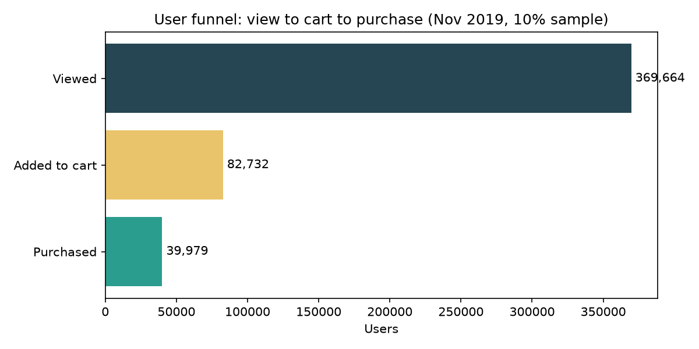
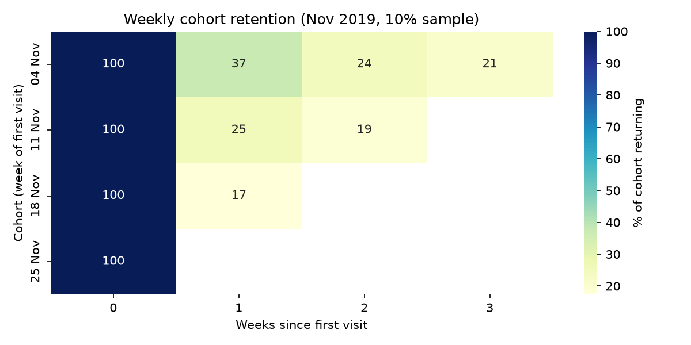
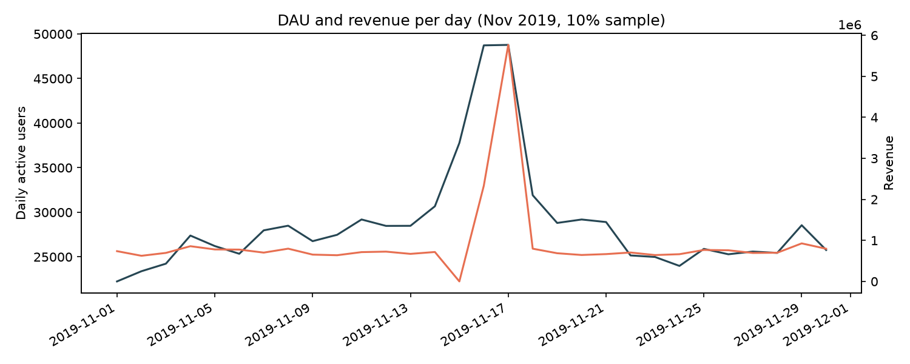

# E-commerce Product Analytics: Funnel, Retention, Metrics & A/B Testing

An end-to-end product analytics project using real e-commerce clickstream data (REES46, November 2019) and a mobile game A/B test (Cookie Cats).

**Tools:** SQL (DuckDB), Python (pandas, statsmodels, matplotlib, seaborn), Git

## 1. Business Questions
1. Where do users drop off between viewing a product and buying?
2. Do new users come back?
3. How healthy are daily activity and revenue?
4. Does moving a game's first gate from level 30 to 40 improve retention?

## 2. Data
- **REES46 e-commerce events**, November 2019: 67.5M events. I analyzed a 10% user sample (369,828 users, 6.7M events), keeping every event for each sampled user so full journeys stay intact.
- **Cookie Cats A/B test:** 90,189 players.
- Cleaning: removed 5.8K duplicate groups and 18.9K rows with price <= 0. Rows with missing brand or category were kept. Details are in `docs/assumptions.md`.

## 3. Key Findings

### Funnel

- 22.4% of viewers added to cart, and 48.3% of cart users purchased (about 10.8% overall, measured per user across the month, not per session).
- Electronics converts best (22% view-to-cart, 50% cart-to-purchase). Apparel is the weakest large category (5.5% view-to-cart, 32.5% cart-to-purchase).

### Retention

- Week-1 retention fell from 37% (4 Nov cohort) to 25% (11 Nov) and 17% (18 Nov). The 4 Nov cohort is likely inflated because data starts on 1 Nov.

### Core metrics

- Daily active users were steady at 25-30K, with a spike to about 48K on 16-17 Nov.
- **Data quality issue:** 15 Nov has zero purchase events despite 37K active users. Daily revenue and conversion for 14-17 Nov are unreliable.

### A/B test
- Day-7 retention: 19.02% (gate_30) vs 18.20% (gate_40), a drop of 0.82 percentage points (p = 0.0016).
- 95% CI for the difference: [-1.33%, -0.31%]. Bootstrap check: [-1.33%, -0.32%].
- **Recommendation: do not ship gate_40.**

## 4. Recommendations
1. Test size guides and fit information on apparel pages (metric: view-to-cart rate).
2. Test cart reminders and a simpler checkout (metric: cart-to-purchase rate).
3. Confirm with data engineering whether purchases were logged late around 15 Nov.
4. Keep the gate at level 30.

## 5. Limitations
- 10% user sample from one month.
- The user-level funnel does not check event order.
- No revenue data in Cookie Cats, so I could not check the in-app purchase trade-off.
- Retention for the first cohort is overstated.

## 6. Repository Structure
```
data/        (raw data not included, see sources below)
sql/         funnel, retention and metrics queries
notebooks/   data loading, funnel, retention, metrics, A/B test
images/      charts
docs/        assumptions and findings
```

## 7. How to Run
1. Download `2019-Nov.csv` (REES46) and `cookie_cats.csv` from Kaggle into `data/raw/`.
2. `python -m venv venv`, activate it, then `pip install -r requirements.txt`.
3. Run the notebooks in order (01 to 05).

## Data sources
- REES46 eCommerce behavior data from a multi-category store (Kaggle, mkechinov)
- Mobile Games A/B Testing, Cookie Cats (Kaggle)

**Author:** Ashmit Kumar Sahu | [LinkedIn](https://www.linkedin.com/in/ashmit-kumar-sahu-7a2104265/)